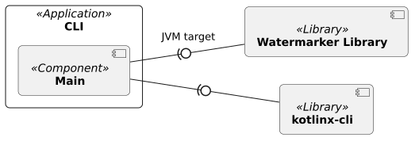

<!--
 Copyright (c) 2026 Fraunhofer-Gesellschaft zur Förderung der angewandten Forschung e.V.

 This work is licensed under the Fraunhofer License (on the basis of the MIT license)
 that can be found in the LICENSE file.
-->

# Building Block View

[↑ Go to Level 1](../)

## Level 2: CLI (Whitebox)

### Purpose / Responsibility

The command line interface (CLI) is based on
the [Kotlin CLI parser kotlinx-cli](https://github.com/Kotlin/kotlinx-cli), aiming to bring
watermarking functionalities into the terminal. It is able to embed and extract watermarks from
Strings directly in the terminal and files. The CLI tool is easy to extand with custom
commands and arguments. Under the hood, it uses
the [Innamark watermark library](#level-2-watermarker-library) with the Java build target as
Gradle dependency.

#### Expansion
To expand upon the CLI tool's current functionality you will have to:
- Create a new `kotlinx.cli.Subcommand` class for argument parsing within the `cli` function.
- Create a new function for the new actions that can be called by the subcommand class's 
  `execute` override function.
- For top-Level commands (like `Add`, `Text`, `Remove`):
  - Add the new subcommand class to the `parser.subcommands` list within the `cli` function.
- For lower-Level commands (like `TextAdd`, `TextList`, `TextRemove`):
  - Register the new subcommand to the parent subcommand class using the `init` block and `this.
  subcommands`.

### Contained Blackboxes

| Building Block                                                                               | Description                                                                                                                                                     |
|----------------------------------------------------------------------------------------------|-----------------------------------------------------------------------------------------------------------------------------------------------------------------|
| [**Main**](https://github.com/FraunhoferISST/Innamark/blob/main/cli/src/main/kotlin/Main.kt) | The Main file contains the full logic of the CLI tool, like parsing CLI arguments and executing them.                                                           |
| [**Watermarker Library**](#level-2-watermarker-library-whitebox)                             | A Kotlin multiplatform libray, offering watermark embedding and extraction functionalities, integrated as external Gradle dependency with the JVM build target. |
| [**kotlinx-cli**]((https://github.com/Kotlin/kotlinx-cli))                                   | A generic command-line parser for Kotlin, integrated as external Gradle dependency.                                                                             |
