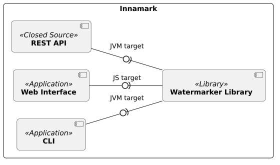

<!--
SPDX-FileCopyrightText: 2026 Fraunhofer-Gesellschaft zur Förderung der angewandten Forschung e. V.

SPDX-License-Identifier: LicenseRef-Fraunhofer-Gesellschaft
-->

# Building Block View

This section decomposes Innamark into its components, modules and classes. Each level shows more 
details.

## Level 1: Innamark (Whitebox)

Innamark is not one single component or application. It is a full ecosystem of various building blocks,
each as its own subproject, offering different functionalities.

### Contained Blackboxes

| Building Block                                    | Description                                                                                         |
|---------------------------------------------------|-----------------------------------------------------------------------------------------------------|
| [**Watermarker Library**](watermarker-library.md) | A Kotlin multiplatform library, offering watermark embedding and extraction functionalities.        |
| [**Web Interface**](webinterface.md)              | A graphical user interface (GUI) to embed and extract watermarks.                                   |
| [**CLI**](cli.md)                                 | A command line interface (CLI) as a terminal solution for watermark embedding and extraction.       |
| [**REST API**](rest-api.md)                       | A closed-source implementation of an API, offering watermarking embedding and extraction endpoints. |
