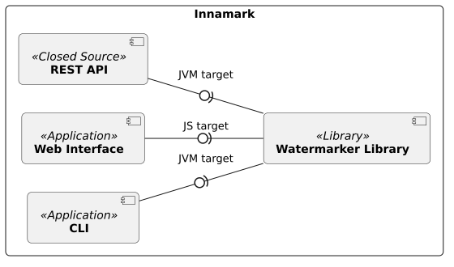

<!--
 Copyright (c) 2026 Fraunhofer-Gesellschaft zur Förderung der angewandten Forschung e.V.

 This work is licensed under the Fraunhofer License (on the basis of the MIT license)
 that can be found in the LICENSE file.
-->

# Building Block View

This section decomposes Innmark into its components, modules and classes. Each level shows more 
details.

## Level 1: Innamark (Whitebox)

Innamark is not one single component or application. It is a full ecosystem of various building blocks,
each as its own subproject, offering different functionalities.

### Contained Blackboxes

| Building Block                                                   | Description                                                                                         |
|------------------------------------------------------------------|-----------------------------------------------------------------------------------------------------|
| [**Watermarker Library**](watermarker-library/) | A Kotlin multiplatform libray, offering watermark embedding and extraction functionalities.         |
| [**Web Interface**](webinterface)             | A graphical user interface (GUI) to embed and extract watermarks.                                   |
| [**CLI**](cli)                                 | A command line interface (CLI) as a terminal solution for watermark embedding and extraction.       |
| [**REST API**](rest-api)                       | A closed-source implementation of an API, offering watermarking embedding and extraction endpoints. |
