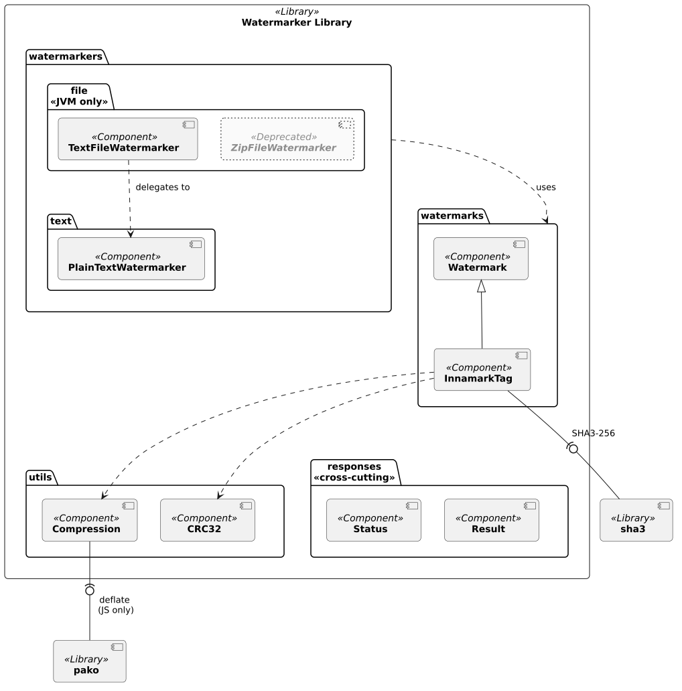
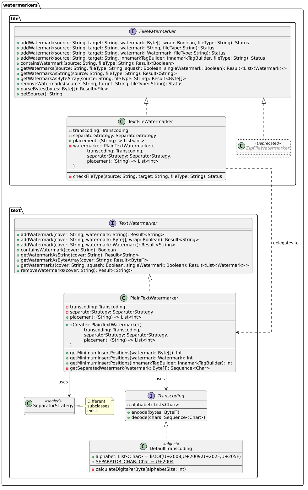
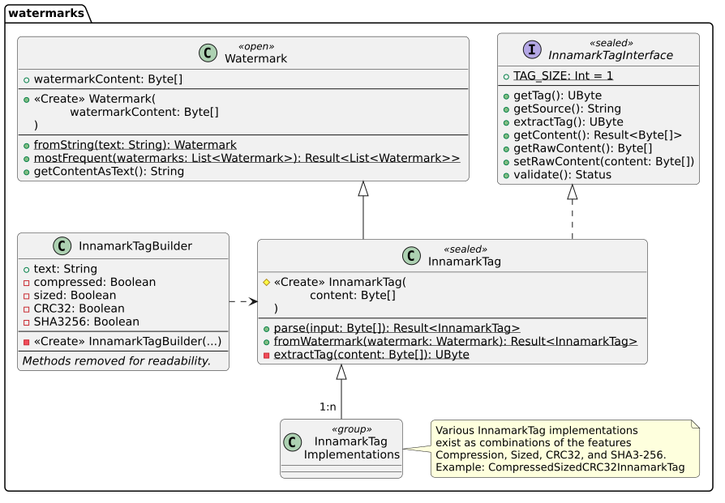
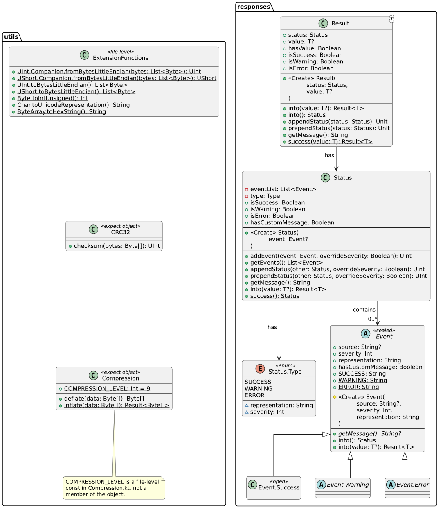

<!--
 Copyright (c) 2026 Fraunhofer-Gesellschaft zur Förderung der angewandten Forschung e.V.

 This work is licensed under the Fraunhofer License (on the basis of the MIT license)
 that can be found in the LICENSE file.
-->

# Building Block View

[↑ Go to Level 1](../)

## Level 2: Watermarker Library (Whitebox)

### Purpose / Responsibility

The watermarker library is the hearth of Innamark, containing the main watermark logic and
functionalities. It is written as a [Kotlin multiplatform](https://kotlinlang.org/multiplatform/)
library and thus able to be built for Java (JVM) and JavaScript (JS) applications to integrate
watermarking into backend and frontend applications. The library is highly flexible and
extensible and comes with various utilities, interfaces, and builders. It aims to increase the
developer experience to easily integrate Innamarks watermarking mechanisms into other applications.

### Contained Blackboxes

| Building Block                                                          | Description                                                                                                                                                                                              |
|-------------------------------------------------------------------------|----------------------------------------------------------------------------------------------------------------------------------------------------------------------------------------------------------|
| [**Watermarkers**](#level-3-watermarkers-whitebox): Text & File         | All functionalities executing the embedding and extraction of a watermark inside a cover text are part of the `watermarkers` package. It is structured by the type of cover text (e.g., `text`, `file`). |
| [**Watermarks**](#level-3-watermarks-whitebox): Watermark & InnamarkTag | The `watermarks` package offers different types of watermarks, with the Watermark as a baseline and our custom InnamarkTag as a special format.                                                          |
| [**Generic**](#level-3-generic-whitebox): Utils & Responses             | Various generic utilities, custom responses and status types are clustered as these generic cross-cutting concepts, split over different packages.                                                       |
| [**sha3**](https://github.com/KotlinCrypto/hash/tree/master/library/sha3)   | Module inside [KotlinCrypto/hash](https://github.com/KotlinCrypto/hash), a Kotlin Multiplatform library offering cryptographic hash functions, integrated as external Gradle dependency.                 |
| [**pako**](https://github.com/nodeca/pako)                                  | A zlib-compatible compression dependency, used in the JS build target only, integrated as external Gradle dependency as npm resource.                                                                    |

## Level 3: Watermarkers (Whitebox)

### Purpose / Responsibility

The `watermarkers` package aims for adding functionalities to embed a watermark in a specific 
cover. It mainly focuses on adding watermarks to covers, checking if an existing text contains a 
watermark, getting and extracting watermarks out of a cover, and removing watermarks from 
watermarked covers.
It is separated into the sub-packages:
- `text`: Specific functionalities to watermark different types of text
- `file`: Specific functionalities to watermark files (only available for JVM, not for JS)

Currently, only two actively maintained classes exist: A `PlainTextWatermarker` (in the `text` 
package), which aims to embed a watermark in a plain text cover and a `TextFileWatermarker` (in 
the `file` package), which aims to open a text file first, read the plain text and delegate the 
watermarking to the `PlainTextWatermarker` afterward.

Future implementations could include other watermarkers in the `text` package, like HTML/JSON 
watermarker, which also work on pure text, but ensure the funtionalities of HTML/JSON persist. 
Other `file` watermarks could handle specific file types.

### Contained Blackboxes

#### `file` Package Building Blocks

These building blocks are part of `jvmMain` and therefore only available in the Java build target.

| Building Block                                                                                                                                                       | Description                                                                                                                                                                                                                                                                                   |
|----------------------------------------------------------------------------------------------------------------------------------------------------------------------|-----------------------------------------------------------------------------------------------------------------------------------------------------------------------------------------------------------------------------------------------------------------------------------------------|
| [**FileWatermarker**](https://github.com/FraunhoferISST/Innamark/blob/main/watermarker/src/jvmMain/kotlin/watermarkers/file/FileWatermarker.kt)                      | Interface for implementations facilitating watermarking of file covers. It contains method signatures for adding different types of watermarks into a cover, checking if a cover contains watermarks, extracting watermarks from covers, and removing watermarks.                             |
| [**TextFileWatermarker**](https://github.com/FraunhoferISST/Innamark/blob/main/watermarker/src/jvmMain/kotlin/watermarkers/file/TextFileWatermarker.kt)              | Implementation of the `FileWatermarker` for watermarking text files. It can optional be configured with arguments for custom transcoding, seperator strategies, and placements. It handels the file reading to get the plain text to delegate the watermarking to the `PlainTextWatermarker`. |
| _[**ZipFileWatermarker**](https://github.com/FraunhoferISST/Innamark/blob/main/watermarker/src/jvmMain/kotlin/watermarkers/file/ZipFileWatermarker.kt) (deprecated)_ | _Implementation of the `FileWatermarker` for watermarking ZIP files which is deprecated and therefore not further described here._                                                                                                                                                            |

#### `text` Package Building Blocks
| Building Block                                                                                                                                                    | Description                                                                                                                                                                                                                                                                                                             |
|-------------------------------------------------------------------------------------------------------------------------------------------------------------------|-------------------------------------------------------------------------------------------------------------------------------------------------------------------------------------------------------------------------------------------------------------------------------------------------------------------------|
| [**TextWatermarker**](https://github.com/FraunhoferISST/Innamark/blob/main/watermarker/src/commonMain/kotlin/watermarkers/text/TextWatermarker.kt)                | Interface for implementations facilitating watermarking of `String` covers. It contains method signatures for adding different types of watermarks into a text, checking if a text contains watermarks, extracting watermarks from texts, and removing watermarks.                                                      |
| [**PlainTextWatermarker**](https://github.com/FraunhoferISST/Innamark/blob/main/watermarker/src/commonMain/kotlin/watermarkers/text/PlainTextWatermarker.kt#L136) | Implementation of the `TextWatermarker` for watermarking pure plain text. It can optional be configured with arguments for custom transcoding, seperator strategies, and placements. It has additional functionalities to check the minimum insert positions needed for a watermark to be embedded inside a cover text. |
| [**SeparatorStrategy**](https://github.com/FraunhoferISST/Innamark/blob/main/watermarker/src/commonMain/kotlin/watermarkers/text/PlainTextWatermarker.kt#L27)     | Defines multiple strategies on how to separate multiple watermarks in one cover text (e.g., by inserting a special char between watermarks or specific chars at the start/end of a watermark).                                                                                                                          |
| [**Transcoding**](https://github.com/FraunhoferISST/Innamark/blob/main/watermarker/src/commonMain/kotlin/watermarkers/text/PlainTextWatermarker.kt#L43)           | Interface to define an encoding and decoding function based on an alphabet (a list of chars), to transform a text- or byte-encoded watermark into a such a list of alphabet chars.                                                                                                                                      |
| [**DefaultTranscoding**](https://github.com/FraunhoferISST/Innamark/blob/main/watermarker/src/commonMain/kotlin/watermarkers/text/PlainTextWatermarker.kt#L53)    | Implemented object of the `Transcoding`, defining our default alphabet (4 Unicode spaces) and separator char (1 Unicode space), used to encode/decode watermarks.                                                                                                                                                       |

## Level 3: Watermarks (Whitebox)

### Purpose / Responsibility

The `watermarks` package handles everything related to the watermarks itself, so the content
embedded into the cover text. The Innamark projects uses objects of the `Watermark` class as one 
uniform data type for these watermarks. One special type of watermarks are InnamarkTags, which 
can be illustrated as a well-defined 1-Byte-long tag + the watermark itself (see [cross-cutting 
concepts](../../concepts)).

### Contained Blackboxes

| Building Block                                                                                                                                            | Description                                                                                                                                                                            |
|-----------------------------------------------------------------------------------------------------------------------------------------------------------|----------------------------------------------------------------------------------------------------------------------------------------------------------------------------------------|
| [**Watermark**](https://github.com/FraunhoferISST/Innamark/blob/main/watermarker/src/commonMain/kotlin/types/watermarks/Watermark.kt)                     | Our internal data type to transform a sequence of bytes or a String into a `Watermark` object.                                                                                         |
| [**InnamarkTagInterface**](https://github.com/FraunhoferISST/Innamark/blob/main/watermarker/src/commonMain/kotlin/types/watermarks/InnamarkTag.kt#L27)    | Interface to define an InnamarkTag, described in more detail in the [cross-cutting concepts](../../concepts). Simply explained, it is a well-defined tag placed before each watermark. |
| [**InnamarkTag**](https://github.com/FraunhoferISST/Innamark/blob/main/watermarker/src/commonMain/kotlin/types/watermarks/InnamarkTag.kt#L101)            | Specific implementation of the `InnamarkTagInterface`, which transforms the content into a `Watermark`.                                                                                |
| [**InnamarkTagBuilder**](https://github.com/FraunhoferISST/Innamark/blob/main/watermarker/src/commonMain/kotlin/types/watermarks/InnamarkTagBuilder.kt)   | Usage of the [builder design pattern](https://en.wikipedia.org/wiki/Builder_pattern) to create InnamarkTags.                                                                           |
| [**InnamarkTag Implementations**](https://github.com/FraunhoferISST/Innamark/blob/main/watermarker/src/commonMain/kotlin/types/watermarks/InnamarkTag.kt) | Various classes, each for every every InnamarkTag.                                                                                                                                     |

## Level 3: Generic (Whitebox)

### Purpose / Responsibility

General cross-cutting functionalities used by different building blocks in the watermarker 
library.

The `utils` package contains various generic utilities, mostly for lower-level Byte operations 
and aspects used by the InnamarkTag watermark (like CRC32 or compression).

The `responses` includes the logic of our custom return- and error-handling types, consisting of 
the three main building blocks for `Result`, `Status`, and `Event`, described in more detail in the 
[cross-cutting concepts](../../concepts).

### Contained Blackboxes

#### `utils` Package Building Blocks

| Building Block | Description |
|----------------|-------------|
| [**ExtensionsFunctions**](https://github.com/FraunhoferISST/Innamark/blob/main/watermarker/src/commonMain/kotlin/utils/ExtensionFunctions.kt)               | A collection of functions not bundeled into a class used in various parts of the Innamark library. Mostly used for convertions, Byte handling, and parsing.            |
| [**CRC32**](https://github.com/FraunhoferISST/Innamark/blob/main/watermarker/src/commonMain/kotlin/utils/CRC32.kt)               | Calculates the CRC32 checksum, used by the specific watermark type of an InnamarkTag.            |
| [**Compression**](https://github.com/FraunhoferISST/Innamark/blob/main/watermarker/src/commonMain/kotlin/utils/Compression.kt)               | Compresses and uncompresses data in Byte format.            |

#### `responses` Package Building Blocks

| Building Block                                                                                                                            | Description                                                                                                                                            |
|-------------------------------------------------------------------------------------------------------------------------------------------|--------------------------------------------------------------------------------------------------------------------------------------------------------|
| [**Result**](https://github.com/FraunhoferISST/Innamark/blob/main/watermarker/src/commonMain/kotlin/types/responses/Result.kt)            | A return type used by functions that has a return value and are not guaranteed to succeed. It consists of the status and an optional return value and. |
| [**Status**](https://github.com/FraunhoferISST/Innamark/blob/main/watermarker/src/commonMain/kotlin/types/responses/Status.kt#L99)        | A return type used by function that has no return value and are not guaranteed to succeed. A status itself consists of a list of Events.               |
| [**Status.Type**](https://github.com/FraunhoferISST/Innamark/blob/main/watermarker/src/commonMain/kotlin/types/responses/Status.kt#L106)  | An enum for status types which can be success, warning, or error with a representation and severity.                                                   |
| [**Event**](https://github.com/FraunhoferISST/Innamark/blob/main/watermarker/src/commonMain/kotlin/types/responses/Status.kt#L25)         | Represents the three types of events (success, warning, error) with further information like the source and servity.                                   |
| [**Event.Success**](https://github.com/FraunhoferISST/Innamark/blob/main/watermarker/src/commonMain/kotlin/types/responses/Status.kt#L55) | Event type for a successfull function operation.                                                                                                       |
| [**Event.Warning**](https://github.com/FraunhoferISST/Innamark/blob/main/watermarker/src/commonMain/kotlin/types/responses/Status.kt#L66) | Event type for a problematic function operation that is not failed.                                                                                    |
| [**Event.Error**](https://github.com/FraunhoferISST/Innamark/blob/main/watermarker/src/commonMain/kotlin/types/responses/Status.kt#L74)   | Event type for a major error in function operation for failed executions.                                                                              |

