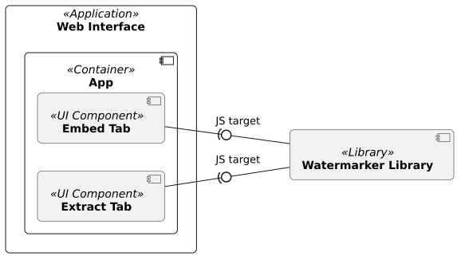

<!--
 Copyright (c) 2026 Fraunhofer-Gesellschaft zur Förderung der angewandten Forschung e.V.

 This work is licensed under the Fraunhofer License (on the basis of the MIT license)
 that can be found in the LICENSE file.
-->

# Building Block View

[↑ Go to Level 1](../)

## Level 2: Web Interface (Whitebox)

### Purpose / Responsibility

The Web Interface is based on the [KVision web framework for Kotlin/JS](https://kvision.io/),
aiming to create a GUI running in the browser to easily embed and extract watermarks. It
consists of a single-page design with two tabs: One for watermark embedding and one for
watermark extraction. It is only able to embed text-watermarks into existing cover texts and
offers configuration possibilities for different watermark types (e.g., compress the watermark,
add a hash to verify the watermark, etc.). Under the hood, it uses the [Innamark watermark
library](#level-2-watermarker-library) with the JavaScript (JS) build target as
Gradle dependency and can be seen as a
frontend for it.

### Contained Blackboxes

| Building Block                                                                                                                    | Description                                                                                                                                                     |
|-----------------------------------------------------------------------------------------------------------------------------------|-----------------------------------------------------------------------------------------------------------------------------------------------------------------|
| [**App**](https://github.com/FraunhoferISST/Innamark/blob/main/webinterface/src/jsMain/kotlin/App.kt)                             | The main container component of the UI, creating the overall page with a tab panel, including the two tabs for embedding and extraction.                        |
| [**Embed Tab**](https://github.com/FraunhoferISST/Innamark/blob/main/webinterface/src/jsMain/kotlin/WatermarkTextEmbedTab.kt)     | The embed tab offers a form for adding watermarks in cover text by using the watermarker library.                                                               |
| [**Extract Tab**](https://github.com/FraunhoferISST/Innamark/blob/main/webinterface/src/jsMain/kotlin/WatermarkTextExtractTab.kt) | The extract tab offers a form for getting watermarks in a text by using the watermarker library.                                                                |
| [**Watermarker Library**](#level-2-watermarker-library-whitebox)                                                                  | A Kotlin multiplatform library, offering watermark embedding and extraction functionalities, integrated as external Gradle dependency with the JS build target. |
