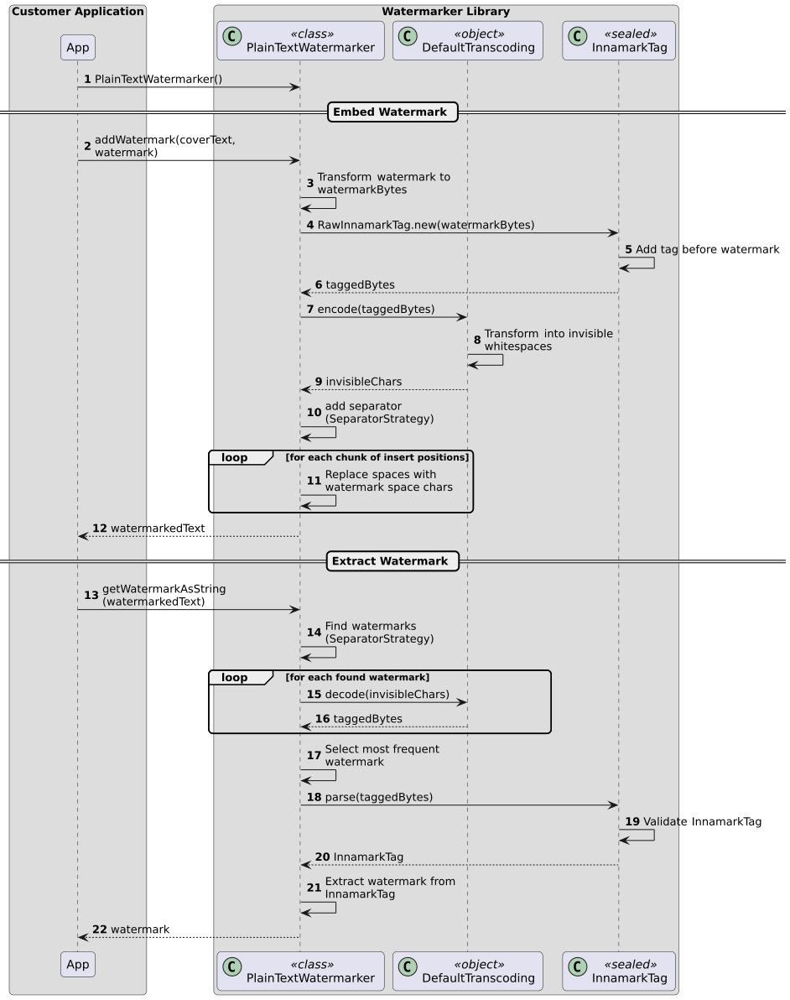

<!--
 Copyright (c) 2026 Fraunhofer-Gesellschaft zur Förderung der angewandten Forschung e.V.

 This work is licensed under the Fraunhofer License (on the basis of the MIT license)
 that can be found in the LICENSE file.
-->

# Runtime View

## Embed and Extract Watermarks

The following sequence diagram describes the watermark embedding and extraction process of a 
text watermark inside a cover text between a possible external customer application (`App`) that 
uses the Innamark watermarker library.
Default configurations and the `RawInnamarkTag` as a special watermark type are used.

More details about the steps:
1. Initialize the `PlainTextWatermarker` with the default configuration (`DefaultTranscoding`, 
   `SeparatorStrategy.SingleSeparatorChar`, and whitespaces for `placement`)

### Embed Watermark
2. The app starts the watermark embedding by passing the `coverText` and the `watermark` (both 
   plain text as Strings) to the Innamark watermark library
3. The `watermark` is transformed from a text String into an array of Bytes
4. The `watermarkBytes` are wrapped into a `RawInnamarkTag`, the default and most simple form 
   of an `InnamarkTag`
5. A 1-Byte long tag is added before the watermark to create `taggedBytes`
6. The `taggedBytes` are the 1-Byte-long tag to indicate the `RawInnamarkTag` + the watermark as 
   Bytes, which is returned to the `PlainTextWatermarker` for further processing.
7. The `taggedBytes` are passed to the `DefaultTranscoding` to encode it into the custom alphabet
8. The `taggedBytes` are transformed into invisible whitespace characters based on the alphabet 
   of the `DefaultTranscoding`
9. The resulting array of `invisibleChars` is returned, which is the encoded watermark as a 
   sequence of similar looking whitespaces
10. The embedding of the watermark into the cover text starts by adding the separator character 
    based on the `SeparatorStrategy` to indicate the start of the watermark
11. Loop through the cover text and replace every classical whitespace with the watermark space 
    chars from the `invisibleChars`
12. Return the watermarked cover text as a `Result` to the customer application

### Extract Watermark
13. The app starts the watermark extraction by passing the `watermarkedText` (cover text 
    including watermark) to the Innamark watermark library
14. The `SeparatorStrategy` is used to find all watermark occurrences in the text
15. Decode the `invisibleChars` of each watermark based on the `DefaultTranscoding`
16. Return the `taggedBytes` for each watermark, which includes the tag and watermark in Byte format
17. Select the most frequent watermark for further processing to ignore damaged or broken watermarks
18. Parse the `taggedBytes` by reading the 1-Byte-long tag to indicate the InnamarkTag type
19. Validate the tag depending on the `InnamarkTag` type (e.g., checking hashes), while it 
    passes for the `RawInnamarkTag`
20. Return the validated and parsed `InnamarkTag` for further processing
21. Extract the watermark from the `InnamarkTag` by removing the starting tag
22. Return the watermark as a `Result` to the customer application
