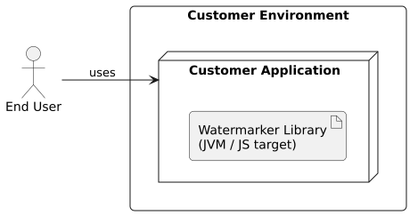
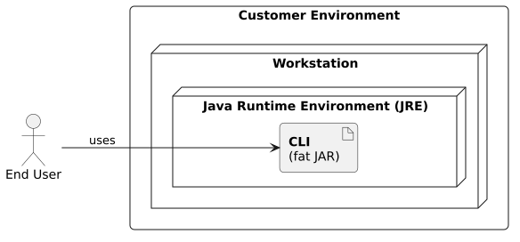
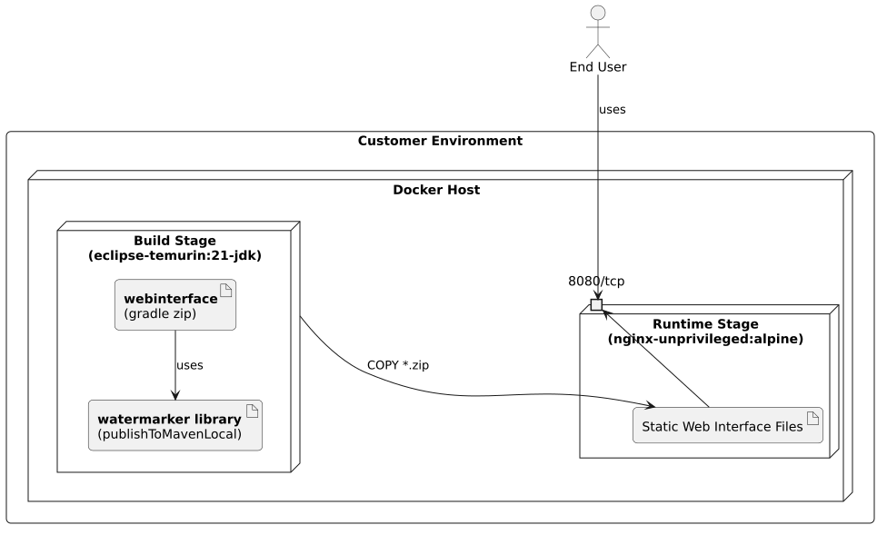
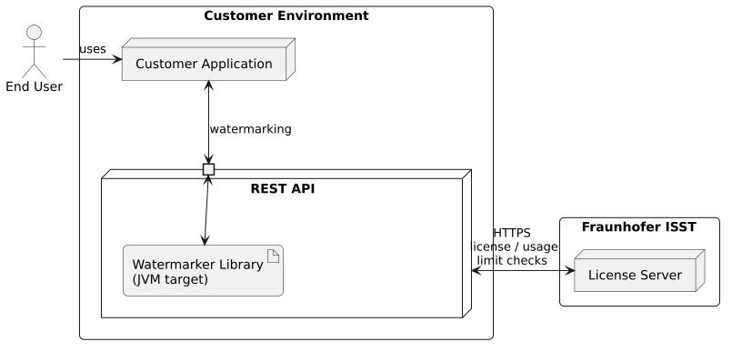

<!--
 Copyright (c) 2026 Fraunhofer-Gesellschaft zur Förderung der angewandten Forschung e.V.

 This work is licensed under the Fraunhofer License (on the basis of the MIT license)
 that can be found in the LICENSE file.
-->

<!-- This file was developed with AI assistance. -->

# Deployment View

Innamark is not a single deployable unit but an ecosystem of independent building blocks that can be
deployed in very different ways (see [Building Block View](../building-block-view)). This section
describes the technical infrastructure and how the building blocks are mapped onto it.

## Infrastructure Overview (Level 1)

### Motivation

Innamark offers independent delivery forms, each with its own deployment story:

- The **Watermarker Library** is a Kotlin Multiplatform artifact (JVM and JS targets). It has no
  infrastructure of its own: it is integrated as a build dependency and executed in-process inside
  the surrounding customer application.
- The **CLI** is a standalone fat JAR. It runs directly on a workstation and only requires a Java
  Runtime Environment (JRE).
- The **Web Interface** is a static single-page application (SPA) built with Kotlin/JS. It is
  self-contained and stateless: all watermarking logic runs client-side in the browser, so no
  backend service, database, or server-side processing is required.
- The **REST API** is a closed-source application, shipped as a pre-build container image to 
  customers.

Currently, no public artifact repository is available. All components need to be build locally.

### Quality and Performance Features

| Feature                | Description                                                                                                                                                                                                                          |
|------------------------|--------------------------------------------------------------------------------------------------------------------------------------------------------------------------------------------------------------------------------------|
| **Data Locality**      | Cover texts and watermarks never leave the customer environment. The Fraunhofer ISST license server only checks usage limits, so no customer data is transferred to external systems.                                                |
| **No Backend**         | The Web Interface and CLI have no server-side component, so there is no additional stateful infrastructure to operate, scale, or secure.                                                                                             |
| **Low Footprint**      | All Innamark components have minimal dependencies and only need a JRE for the CLI tool and the Java build of the watermarker library or a web browser to use the web interface (based on the JS version of the watermarker library). |
| **Hardened Container** | The Web Interface container runs as an unprivileged user (`nginx-unprivileged`) and serves pre-built static assets through nginx.                                                                                                    |
| **Statelessness**      | All applications keep no session state and do not require a connection to a backend. Thus, they can be replicated horizontally behind any load balancer without further coordination.                                                |
| **Offline Capability** | All components run fully offline without internet connectivity, while a production system needs to communicate to the Fraunhofer ISST license server.                                                                                |

### Mapping

The following table maps the [building blocks](../building-block-view) to their resulting 
artifact which runs in the infrastructure.

| Building Block                                                                     | Delivered Artifact                            | Notes                                                                                                                                     |
|------------------------------------------------------------------------------------|-----------------------------------------------|-------------------------------------------------------------------------------------------------------------------------------------------|
| [**Watermarker Library**](../building-block-view/watermarker-library) (JVM target) | JVM Maven artifact from `publishToMavenLocal` | Embedded in a Kotlin/Java customer application as a (Maven/Gradle) build dependency and used as an external library directly in the code. |
| [**Watermarker Library**](../building-block-view/watermarker-library)  (JS target) | JS Maven artifact from `publishToMavenLocal`  | Embedded in a JavaScript customer application as a dependency and used as an external library directly in the code.                       |
| [**CLI**](../building-block-view/cli)                                              | Fat JAR artifact from `shadowJar`             | A stand-alone Java project, started manually from the terminal.                                                                           |
| [**Web Interface**](../building-block-view/webinterface)                           | Static SPA bundle (`*.zip`) for a web server  | A GUI running in the browser and served via a web server, e.g. via nginx as shown in the multi-stage `Dockerfile`.                        |
| [**REST API**](../building-block-view/rest-api)  (closed-source)                   | Pre-build container image                     | A closed-source stand-alone REST API, directly integrated with the license server to make watermarking operations available via API.      |
| **License Server**                                                                 | n/a                                           | A license server handling license and usage limit checks, running inside the Fraunhofer ISST infrastructure.                              |

## Infrastructure Deployment of Components (Level 2)

### Watermarker Library (Embedded)

The watermarker library is not deployed on its own infrastructure. Depending on the build target, it
is directly integrated into the customer application:

- The **JVM target** is published to the local Maven repository and added as a Maven/Gradle 
  dependency inside a Kotlin/Java customer application.
- The **JS target** is added inside a JavaScript customer application (e.g., via a Gradle 
  dependency), resulting in a bundled static JavaScript at build time.

In both cases, the library runs in the same process/environment as its consumer, without any 
separate runtime, service, or network endpoint. Thus, the user acts with the customer 
application only, which includes the watermarking functionalities.

### CLI (Standalone)

The CLI is distributed as a self-contained fat JAR (`cli-<version>-all.jar`) built with the
Gradle `shadowJar` task. It requires only a Java Runtime Environment and is typically invoked from a
shell on a workstation, either directly (`java -jar ...`) or via a shell alias (see [CLI 
Installation](../../docs/usage/cli/installation/)). The user directly interacts with the CLI tool.

### Web Interface (Containerized)

The Web Interface is deployed as a static SPA inside a container. The 
multi-stage [`Dockerfile`](https://github.com/FraunhoferISST/Innamark/blob/main/webinterface/Dockerfile) 
first builds the library and the SPA using `eclipse-temurin:21-jdk`, then copies the resulting 
static bundle into an unprivileged nginx image that serves it on port `8080`.

For a quick local start, the 
root 
[`docker-compose.yml`](https://github.com/FraunhoferISST/Innamark/blob/main/docker-compose.yml) 
builds and serves this container on `http://localhost:8080`. For development, the SPA can also 
be served directly with `./gradlew -t run` on `http://localhost:3000`.

### REST API

As an alternative to directly integrating the watermarker library into the application, a REST 
API service can be deployed into the customer infrastructure that uses the watermarker library 
inside it and offers watermarking functionalities via API endpoints. It connects to the 
Fraunhofer ISST license server for license and usage limit checks.

This component is especially useful for enterprise customers and applications in other languages 
than Kotlin, Java or JavaScript.

#### License Server

Since the core watermarking concept is patent-pending (see
[Context and Scope](./03_context_and_scope.md) and the
[Architecture Constraints](./02_architecture_constraints.md)), a patent license is required in
addition to the license for the software.
See [`LICENSE`](https://github.com/FraunhoferISST/Innamark/blob/main/LICENSE) for more information.

Therefore, a productive deployment needs to be connected to the license server running in the
Fraunhofer ISST infrastructure. This license server only checks the limits via HTTPS
communication. The customer data (cover texts and watermarks) never leaves the customer
environment and are fully processed in the customer environment.
