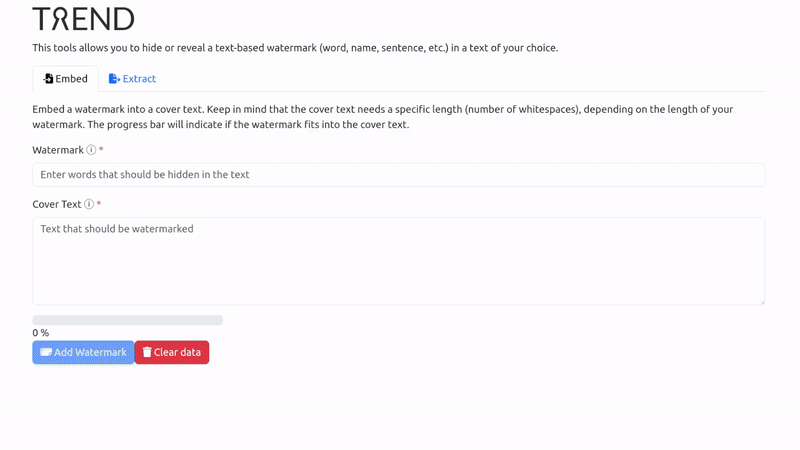

<!--
SPDX-FileCopyrightText: 2024-2026 Fraunhofer-Gesellschaft zur Förderung der angewandten Forschung e. V.

SPDX-License-Identifier: LicenseRef-Fraunhofer-Gesellschaft
-->

# Webinterface

The following example uses our webinterface and Kotlin library to hide the "Innamark" watermark
inside a text, send it via email, and verify and extract the watermark afterward on the recipient
side:

